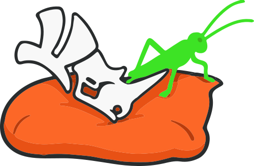
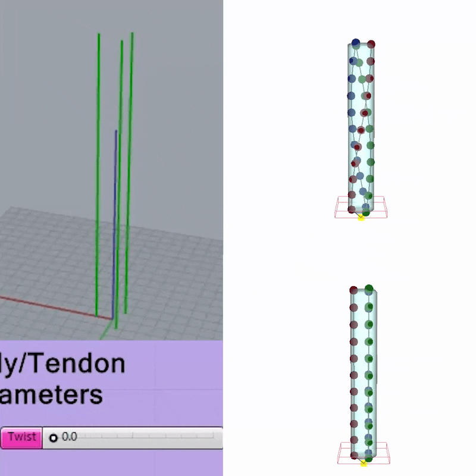

<p align="center">
  
  <br/>
  
</p>

<p align="center">
  <b>Cushion</b> · <i>noun</i><br>
  A soft pad or pillow, usually set on a sofa, that makes a rigid structure
  comfortable to work with.<br>
  Also: an intermediate layer that softens the interface between two hard things.
</p>

<p align="center"><i>Cushion is the soft layer between Grasshopper and SOFA.</i></p>

<p align="center">
  <a href="https://doi.org/10.5281/zenodo.21625292"></a>
  <a href="LICENSE"></a>
  <a href="https://www.youtube.com/playlist?list=PLZcYzST93d40"></a>
</p>

---

**Soft-robotics simulation in Grasshopper, powered by [SOFA](https://www.sofa-framework.org/).**

You describe a soft robot the way you already model in Grasshopper: a
deformable body, the pneumatic cavities or tendons that drive it, and a
schedule of pressures or pulls over time. Cushion meshes the geometry,
writes a runnable SOFA scene, launches the simulation, and brings the
results (trajectories, forces, contacts, deformed shapes) back onto the
canvas.

*Developed by Trevor Exley and Anderson Nardin.*

The scene structure follows the Monolithic Unit soft-robotics pipeline
(Exley, Nardin, Trunin, Cafiso, Beccai; [arXiv:2511.13120](https://arxiv.org/abs/2511.13120)):
corotational tetrahedral FEM, a homogenized lattice material, MeshROI-based
local stiffening, and SoftRobots pressure and cable constraints.

```
GH geometry ──► STL/STEP ──► gmsh tets ──► scene.json + input.csv
                                              │
      GH points/curves ◄── monitor data ◄── runSofa (GUI or batch)
```

## Videos

📺 **Installation tutorial now out.** All Cushion videos live in one
[YouTube playlist](https://www.youtube.com/playlist?list=PLZcYzST93d40):

* [Introducing Cushion](https://www.youtube.com/watch?v=2psFF2CLAok) — release overview.
* [Installation tutorial](https://www.youtube.com/watch?v=xLiRbIvQZjo) — clean machine to first running simulation.

## Status

Working prototype (v0.1), tested on Windows 11 and macOS with Rhino 8 and
SOFA v24.06. The interface may still change.

Licensed under the GNU Lesser General Public License v2.1 or later. See
[LICENSE](LICENSE).

📖 **[Manual (PDF)](docs/manual/Cushion_Manual.pdf)**: component reference,
installation, and a worked example.

## Requirements

* **Rhino 8** with Grasshopper. Document units in millimeters.
* **Cushion plugin** — get it from
  [food4Rhino](https://www.food4rhino.com/en/app/cushion?lang=en) or Rhino's
  Package Manager (`_PackageManager`, search "Cushion"), or drop
  `dist/Cushion.Components.gha` into Grasshopper's Components folder. Needed
  even to open the examples.
* **SOFA v24.06.00** binaries with SofaPython3, SoftRobots, STLIB, and
  SofaValidation (all in the official release bundle):
  [github.com/sofa-framework/sofa/releases/tag/v24.06.00](https://github.com/sofa-framework/sofa/releases/tag/v24.06.00)
* **Python 3.10** on the system (SofaPython3 v24.06 is built against it) with
  `numpy`. This is SOFA's interpreter, separate from Rhino's.
* **gmsh** in Rhino's own CPython. Install it once:
  `"<rhino-python>" -m pip install gmsh` (see [docs/INSTALL.md](docs/INSTALL.md) §5).

Full platform-specific steps: [docs/INSTALL.md](docs/INSTALL.md).

## Quickstart (inflate a cylinder)

1. Install everything per [docs/INSTALL.md](docs/INSTALL.md): the Cushion
   plugin, Pufferfish, SOFA, Python 3.10, and gmsh.
2. In Grasshopper, drop the Cushion components from the **Cushion** tab onto
   the canvas and wire them as below. (Or skip to the examples for ready-made
   definitions.)
3. Model a solid cylinder (r 15, h 100 mm) → `SofaBody.geo`. Put a smaller
   closed cylinder inside → `SofaCavity.geo`, channel 1.
4. Box around one end cap → `SofaBody.fixations`; a few points along the
   axis → `SofaBody.monitorPts`.
5. `PressureProfile`: channel 1, times `[0, 1.0]`, values `[0, 20]` (kPa).
6. `SofaScene`: wire the body and the profile, set `projDir` (a local disk
   folder), `repo` (this folder), `gravityZ` 0, toggle `write` → True.
7. `SofaRun`: `sofaRoot` = your SOFA folder, `gui` True, `run` → True. Press
   **Animate** in the SOFA window.
8. `SofaResults`: wire `scenePath` and `bodyName`, toggle `refresh` → the
   trajectories come back as a DataTree, one branch per frame.

## Examples

Two worked definitions live in [`examples/`](examples). Install the Cushion
plugin first (see [docs/INSTALL.md](docs/INSTALL.md)), then open the `.gh`.
Each has a `.md` walkthrough with a zoomable screenshot of the full canvas.

> **Note:** both examples use the **Reduce Mesh** component from the free
> **Pufferfish** plugin (food4Rhino) — install it before opening them.

**[Tendon continuum robot](examples/continuum_robot.md)**: a cylindrical
backbone driven by three cables at 0° / 120° / 240°. A single run sweeps the
pull direction a full turn while the Monitor logs the backbone every
timestep, so the visited configurations trace out the workspace; the convex
hull of the tip cloud gives its bounds. Nothing to touch, so it runs fast
and makes a good first sim.

<p align="center"></p>

**[PneuNet two-finger gripper](examples/pneunet_gripper.md)**: a
fast-PneuNet finger whose chambers and profile are shaped by Graph Mappers
and meshed with TriRemesh; the cavities become internal voids automatically
(`SofaBody.hollow`), so there is no boolean subtraction anywhere. One finger
is designed flat, oriented twice into a gripper, and carried through a
pick-and-place by a `SofaProtocol` while the chambers inflate: it descends,
grips an object, and lifts it.

<p align="center"></p>

## Components

| Component | Role |
|---|---|
| `SofaBody` | Deformable FEM body: solid, material, fixations, monitor points, placement |
| `SofaCavity` | Pneumatic chamber (SurfacePressureConstraint), driven by channel |
| `SofaTendon` | Cable/tendon path (CableConstraint), displacement- or force-driven |
| `SofaRegion` | Locally stiffened sub-region (membrane/sensor), closed mesh or auto-shell |
| `PressureProfile` | Actuation keyframes for one channel (linear-interpolated, resampled) |
| `SofaProtocol` | Keyframed rigid motion of a whole body (pick-and-place); drags it by its fixations |
| `SofaTarget` | Rigid interaction object (graspable target, obstacle) |
| `SofaScene` | Writes the runnable project (meshes, scene.json, input.csv); optional camera and targets |
| `SofaRun` | Launches runSofa (GUI or headless batch) |
| `SofaResults` | Reads trajectories, forces, contacts, and actuation history back into GH |
| `SofaShape` | Rebuilds the deformed body surface at any exported frame |
| `SetupPreview` | Rebuilds the whole written scene as Rhino geometry, gmsh volume included |

`SofaTendons` and `SofaProfiles` are tree-input variants that drive several
channels from one component. Details, input tables, and modeling notes:
[docs/COMPONENTS.md](docs/COMPONENTS.md).

## Units & conventions

Millimeters, kPa, kg, and seconds throughout; gravity is −9810 mm/s² in z.
SOFA has no built-in up-axis; the gravity vector defines it, and geometry
passes from Rhino to SOFA 1:1 with no transform, so the Rhino document must
be in millimeters.

Young's moduli are effective values: lattice bodies use the homogenized
modulus (Monolithic Unit 1.0×: 18.34 kPa). Heavy lattice geometry belongs in
`visualGeo` only; it is displayed (barycentric-mapped), never meshed or
simulated.

## Common issues

Most problems announce themselves in a component's `info` output or in
`<projDir>/runsofa.log`. Read those first. The ones you're most likely to
hit:

* **Meshing fails ("PLC error", "a segment and a facet intersect").** Two
  input surfaces overlap, usually a cavity poking through a thin body wall.
  Keep cavities fully inside the body, keep walls ≥ 2 mm, and refine the mesh
  (smaller `meshSize` / TriRemesh length, ≤ half the wall thickness).
* **Body free-falls or drifts instead of deforming.** The fixation box isn't
  catching any mesh nodes, or gravity is on with nothing clamped. Make the
  box swallow part of the mesh, or set `gravityZ` 0.
* **Grasp target slips through or flies away.** Check the collision meshes are
  wired on both the body and target, slow the approach, and confirm a floor
  catches the object.
* **`SofaResults` is empty.** `write` was left off, the sim wasn't animated,
  no `monitorPts` were wired, or `bodyName` doesn't match.

Full, field-tested list: [docs/TROUBLESHOOTING.md](docs/TROUBLESHOOTING.md).

## Repo layout

```
sofagh/          pure-Python core (no Rhino): meshing, project writer,
                 runner, results parsers, also usable from plain Python
sofagh/runtime/  generic SOFA scene + controller (copied into projects)
gh/ghcommon.py   RhinoCommon helpers (STL/STEP export, shell offset)
gh/components/   the Grasshopper component scripts
docs/            install, component reference, troubleshooting, manual
examples/        the two walkthroughs above
dist/            compiled Grasshopper plugin (.gha)
```

Any written project folder stands on its own:
`python -m sofagh.runner path/to/project/scene.py [--batch]`.
