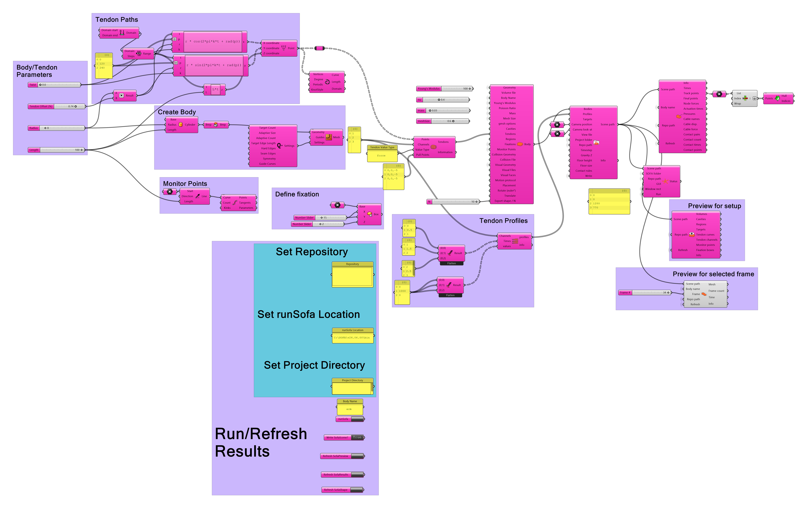
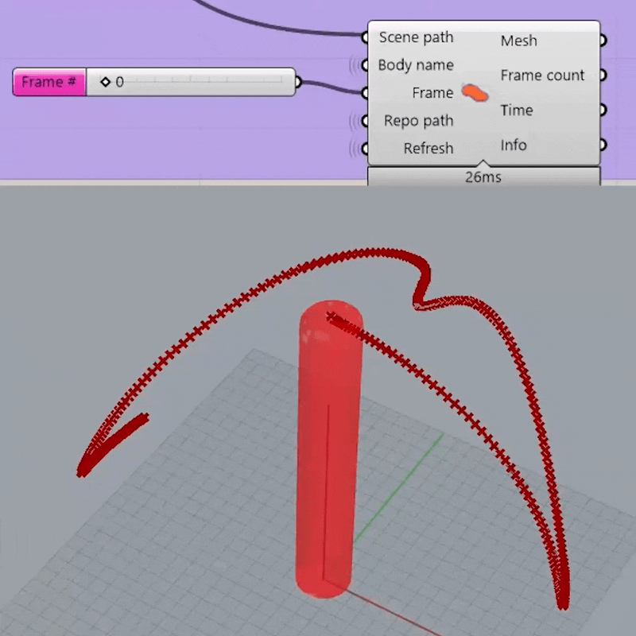

# Example 1: tendon-driven continuum robot + workspace mapping

> **Requires** the Cushion plugin and **Pufferfish** (Reduce Mesh) installed
> first — see [../docs/INSTALL.md](../docs/INSTALL.md).

*The full definition — click the image to open it full-resolution and zoom
into any region: parameters, tendon paths, body, profiles, and the
run/results cluster.*

Everything generated with native Grasshopper blocks, no file inputs.
One simulation run sweeps the pull direction 360°; the Monitor logs the
backbone every timestep, so the visited configurations form the
workspace sample. Convex hull of the tip cloud = workspace bounds.

## Design parameters (suggested starting point)

| Param | Value | Notes |
|---|---|---|
| body radius | 12 mm | |
| body length | 100 mm | |
| tendon radius | 8 mm | route inside the body |
| tendons | 3 at 0°/120°/240° | valueType **force** (multi-cable rule) |
| E / ν / mass | 100 kPa / 0.4 / 0.03 kg | tune E for your material |
| meshSize | 0.4 | check with SetupPreview; smaller = finer |
| Tmax | 500 mN | tune: tip should bend visibly, not buckle |
| gravityZ | 0 | flip to −9810 for gravity-loaded workspace |

## Canvas: block by block

**Body**
1. `Circle` (plane XY, r 12) → `Extrude` (vector 0,0,100) → `Cap Holes`
   → `SofaBody.geo`.
2. `SofaBody`: name `trunk`, E 100, nu 0.4, mass 0.03, meshSize 0.4.

**Tendons ×3** (make one group, copy for φ = 0/120/240)
1. Point A = (8·cos φ, 8·sin φ, 0), Point B = same xy, z 95
   (`Expression` or `Rotate` a template line around the axis).
2. `Line` A→B → `Divide Curve` (N 10) → points → `SofaTendon.pts`.
3. `SofaTendon`: channel 1/2/3, valueType `force`. `pathPts` output
   previews the routing.
4. All three `tendon` outputs → `Merge` → `SofaBody.tendons`.

**Fixation + monitoring**
1. `Center Box` at (0,0,2), X 30 / Y 30 / Z 4 → `SofaBody.fixations`.
2. Backbone points: `Series` (start 5, step 10, count 10) →
   `Construct Point` (0,0,z) → `SofaBody.monitorPts`.

**Sweep profiles** (native math)
1. `Series`: k = 0…12 (13 keyframes) → times = k (seconds).
2. Per cable i (φᵢ = 0/120/240°): values_k = Tmax · max(0, cos(30°·k − φᵢ)) via one `Expression` component: `Tmax*max(0, cos(rad(30*k - phi)))`
   with k the series and phi a slider per copy.
3. Three `PressureProfile` (channels 1/2/3, shared times, own values)
   → `Merge` → `SofaScene.profiles`.

At most two cables pull at once; the resultant pull direction rotates
360° over 12 s. Add a second sweep at Tmax/2 (append 13 more keyframes)
for interior coverage if wanted.

**Scene + run**
1. `SofaScene`: projDir e.g. `C:\SOFA\projects\continuum1`, gravityZ 0,
   no floor, no collision (nothing to touch, keep it fast), write.
2. `SetupPreview`: check tet surface density, tendon points inside the
   volume, fixation box swallowing the base.
3. `SofaRun`: gui True first (watch one sweep), then batch for the real
   run. ~13 s sim ≈ 1300 steps.

**Post-processing**
1. `SofaResults` (bodyName `trunk`): `points` = tree, branch per frame.
2. Tip cloud: `List Item` (index −1) on each branch, e.g. `Flip Matrix`
   → last branch, or `Tree Statistics` + `Tree Branch`. Preview as
   point cloud.
3. Convex hull of the tip cloud (native GH hull component):
   hull mesh + volume. Backbone cloud (flattened `points`) hulled
   separately gives the swept-body bound.
4. `cableForce` / `cableDisp` → Quick Graph: commanded cosine lobes
   should appear in force; displacement shows the resulting shortening.

*Generate deformed meshes with `SofaShape` and characterize the workspace
with `SofaResults`.*

## Tuning notes

* Tip barely moves → raise Tmax or lower E. Body buckles/jitters →
  lower Tmax, raise mesh density, or add slight rayleigh (already 0.1).
* Quasi-static quality: slower sweep (2 s per direction) reduces
  dynamic overshoot; check that force lobes and displacement peaks
  align in time.
* Workspace volume is the single scalar to report; it's also the
  natural objective for later optimization demos (tendon count/angle
  vs workspace).
