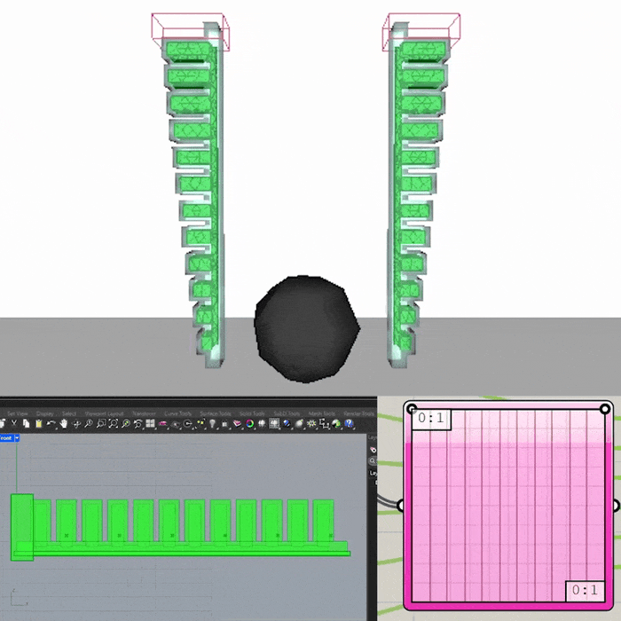

# Example 2: PneuNet two-finger gripper

> **Requires** the Cushion plugin and **Pufferfish** (Reduce Mesh) installed
> first — see [../docs/INSTALL.md](../docs/INSTALL.md).

*The full definition — click the image to open it full-resolution and zoom
into any region: finger parameters, collision model, orientation, protocol,
target, and the run/results cluster.*

Native-Grasshopper pneunet: chamber sizes and finger profile driven by
Graph Mappers, meshed with TriRemesh, cavities become internal voids
automatically (SofaBody.hollow, default on), no boolean difference
anywhere. One finger designed flat, oriented twice into a gripper,
carried by a SofaProtocol pick-and-place.

## Stage A: slitted (fast-PneuNet) body

Master sliders: L 90, W 16, H 14, nCham 10, wall 2, botT 4, slit 2,
res 2. Derived Expressions: finRegion = L-8, chPitch = finRegion/nCham,
finLen = chPitch-slit, finHmax = H-botT, cavRes = min(res, wall).

1. Range (0->1, nCham-1 steps) -> Graph Mapper (fin/chamber profile)
   -> Remap to [0.6*finHmax, finHmax] = fin heights hi
2. Series (start 4+chPitch/2, step chPitch, count nCham) = finX
3. Fins: Center Box at (finX, 0, botT+hi/2), half-extents
   (finLen/2, W/2, hi/2)
4. Base: Center Box at (L/2, 0, botT/2), halves (L/2, W/2, botT/2)
5. Solid Union (fins + base) = BODY. Air slits between the fins are what
   make the fast-PneuNet curl at low pressure

## Stage B: chamber network

6. Chambers: Center Box at (finX, 0, botT+(hi-wall-0.5)/2), halves
   ((finLen-2*wall)/2, (W-2*wall)/2, (hi-wall+0.5)/2); dip 0.5 into
   the base to meet the channel
7. Channel: Center Box at (L/2, 0, botT-1), halves
   ((finRegion-slit)/2, 1.5, 1)
8. Solid Union (chambers + channel) = CAVITY (one network, channel 1)

## Stage C: meshes and layers

9. TriRemesh (BODY, TargetLength res) -> SofaBody.geo
10. TriRemesh (CAVITY, TargetLength cavRes) -> SofaCavity.geo
11. Strain layer: Center Box (L/2, 0, 0.6), halves (L/2+1, W/2+1, 0.8)
    -> SofaRegion.geo, E 2000
12. Fixation: Center Box (2, 0, H/2), halves (4, W/2+2, H/2+2)
13. Monitors: Series x (0.15*L, step 0.8*L/5, 6) -> points (x, 0, botT+2)

## Stage D: single-finger inflation test

* SofaCavity: mesh from step 10, channel 1
* SofaRegion: slab from step 11, E 2000 (strain-limiting layer: the
  pneunet bends instead of ballooning; MU-membrane mechanism)
* SofaBody: geo from step 9, name finger1, E 80, nu 0.4, mass 0.02,
  meshSize 0.4, fixation from step 12, monitorPts
  (x, 0, 13) x = 15…85, exportShape 10
* PressureProfile ch1: [0, 2] / [0, 60]
* SofaScene gravityZ 0 → write → SetupPreview (voids visible in the
  tet surface, slab at bottom, box swallowing the base) → SofaRun GUI
* Success: finger curls toward the bottom layer. More curl: pressure up
  or thinner top walls. Ballooning: region E up.

## Stage E: gripper assembly

* SofaBody ×2 (finger1/finger2, same geo/cavity/region wires), each
  with an Orient component: World XY → vertical plane, fingertip down,
  bottom layer facing the object, gap ≈ 20 mm.
* collisionGeo on both fingers (the TriRemesh mesh).
* SofaProtocol (both bodies): times [0, 1, 2.5, 3.5],
  offsets (0,0,0) (0,0,−30) (0,0,−30) (0,0,30), down, hold, lift.
* PressureProfile ch1 (both cavities on ch1):
  times [0, 1, 1.2, 2.3, 4], values [0, 0, 55, 55, 55]: inflate
  during the hold, keep gripping through the lift.
* SofaTarget: Sphere r 12 at the grasp point, mass 0.01.
* SofaScene: floorZ at the sphere's resting height, gravityZ −9810.
* Results: SofaShape frame slider for the grasp playback (GIF),
  SofaResults pressures + fingertip trajectories.

## Tuning notes

* Chamber walls ≥ 2 mm and TriRemesh TargetLength ≤ wall thickness
  (at least ~2 elements through the membrane).
* Target slips: raise pressure, narrow the gap, or soften fingers.
* Target flies away on contact: slow the protocol descent, lower mass
  asymmetry, check the floor catches it.
